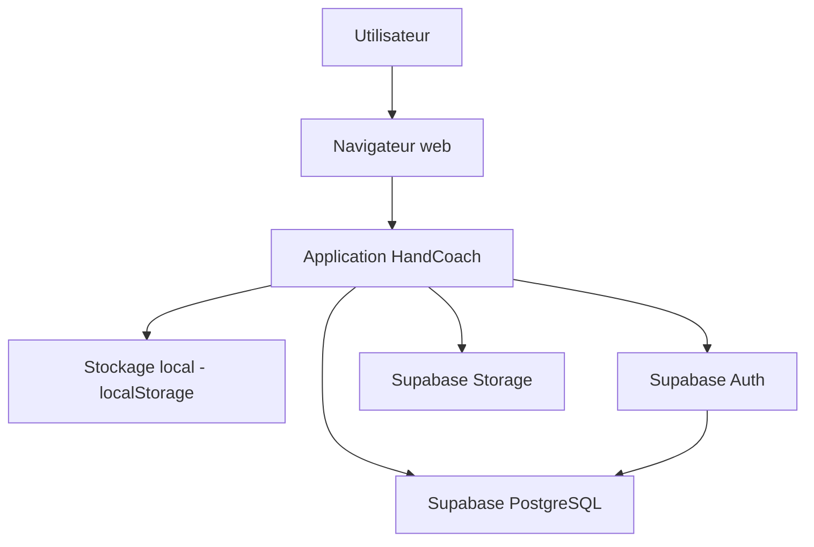

# HandCoach

**Application web de création et d'organisation d'entraînements de handball.**

HandCoach est un projet personnel né d'un besoin concret d'entraîneur : préparer des exercices visuels, construire des séances et partager des ressources avec d'autres coachs.

Le projet est développé en HTML, CSS et JavaScript, avec l'appui d'outils d'intelligence artificielle. Il évolue au fil de son utilisation et des retours du terrain.

---

## Présentation

HandCoach permet de concevoir des exercices sur un terrain de handball, de les classer dans une bibliothèque et de les assembler en séances structurées.

### Éditeur d'exercices

- Terrain de handball interactif.
- Ajout et déplacement de joueurs, plots, ballons, formes et textes.
- Dessin libre et tracé de trajectoires.
- Deuxième terrain pour représenter une évolution de situation.
- Annulation et rétablissement des actions.
- Champs de description : mise en place, consignes, variantes, objectifs et durée.

### Bibliothèque et séances

- Classement des exercices par catégories personnalisables.
- Création de séances à partir des exercices existants.
- Organisation et réordonnancement des exercices dans une séance.
- Thèmes de séances personnalisables.
- Impression d'un exercice ou d'une séance depuis le navigateur.

### Comptes et partage

- Création de compte et connexion par adresse e-mail et mot de passe.
- Réinitialisation du mot de passe.
- Bibliothèques partagées entre coachs.
- Codes d'invitation avec deux niveaux d'accès prévus : lecture et modification.
- Association des membres aux bibliothèques.
- Déconnexion automatique après 15 minutes d'inactivité, avec avertissement deux minutes avant.

### Personnalisation

- Ajout d'un logo de club.
- Réglage de la taille, de l'opacité et de la position du logo.
- Personnalisation des couleurs des joueurs et des plots.
- Choix d'une image de fond.
- Paramètres associés au compte utilisateur lorsqu'il est connecté.

---

## Aperçu de l'application

Les captures d'écran de l'application seront ajoutées ici afin de présenter les principaux écrans :

- Éditeur d'exercices.
  

- Bibliothèque d'exercices.
  

- Préparation d'une séance.
  

- Gestion des bibliothèques partagées.
  

---

## Architecture et technologies

### Technologies utilisées

| Domaine | Technologies |
|---|---|
| Interface | HTML5, CSS3 |
| Logique applicative | JavaScript natif (Vanilla JS) |
| Authentification | Supabase Auth |
| Base de données | PostgreSQL via Supabase |
| Stockage de fichiers | Supabase Storage |
| Persistance locale | localStorage |
| Bibliothèque cliente | Supabase JavaScript v2 |

### Vue d'ensemble

L'application s'exécute dans le navigateur. Les exercices et les séances peuvent être conservés localement. Lorsqu'un utilisateur est connecté, l'application charge et enregistre les données dans Supabase.

Les principales ressources utilisées dans la base sont :

- `Exercices` : données des exercices.
- `seances` : séances et éléments qui les composent.
- `teams` : bibliothèques partagées.
- `team_members` : membres associés aux bibliothèques.
- `user_settings` : paramètres de personnalisation.

Le stockage Supabase `handcoach-assets` est utilisé pour les logos et images de fond des utilisateurs.

Les opérations de création et de partage des bibliothèques s'appuient notamment sur des fonctions PostgreSQL (RPC), comme `create_team`, `create_invite_code` et `join_team_with_code`.

---

## Données et sécurité

- L'authentification est gérée par Supabase Auth.
- L'application utilise une clé publique Supabase côté navigateur. Aucune clé secrète de service ne doit être exposée dans le code client.
- Les accès aux données doivent être protégés par des politiques RLS adaptées aux tables et aux fonctions PostgreSQL.
- Les droits de partage proposés dans l'application distinguent la lecture et la modification.

**Important :** la présence de Supabase Auth et de rôles dans l'interface ne suffit pas à démontrer que la base est sécurisée. Les politiques RLS, les permissions SQL et les fonctions RPC doivent être vérifiées dans le projet Supabase avant toute mise en production ou utilisation avec des données sensibles.

---

## Fonctionnement et limites actuelles

- L'application peut conserver localement certaines données et préférences avec `localStorage`.
- La synchronisation des données personnelles et partagées nécessite une connexion à Supabase.
- Le fonctionnement hors ligne reste partiel : il ne faut pas considérer l'application comme une solution complète de synchronisation différée.
- L'interface et la logique applicative sont actuellement regroupées dans un fichier HTML. Une séparation en plusieurs fichiers et une meilleure modularisation constituent des axes d'amélioration.
- L'impression est réalisée depuis le navigateur ; l'utilisateur peut choisir une imprimante ou une destination PDF.

---

## Lancer le projet

Le dépôt contient une application web statique.

1. Récupérer le dépôt.
2. Ouvrir `index.html` dans un navigateur récent ou publier les fichiers sur un hébergement web statique.
3. Pour utiliser les fonctions cloud, disposer d'un projet Supabase configuré avec les tables, fonctions, politiques d'accès et le bucket attendus par l'application.

L'ouverture locale du fichier permet de tester l'interface, mais les fonctions qui dépendent de Supabase nécessitent un accès réseau et une configuration valide.

---

## Pistes d'amélioration

- Ajouter des captures d'écran et une démonstration guidée.
- Modulariser le code en séparant HTML, CSS et JavaScript.
- Renforcer et documenter les tests fonctionnels.
- Vérifier et documenter les politiques RLS et les permissions des fonctions RPC.
- Améliorer le fonctionnement hors ligne et la gestion des conflits de synchronisation.
- Poursuivre l'amélioration de l'ergonomie sur ordinateur, tablette et mobile.

---

## Démarche et apprentissages

Ce projet m'a permis de travailler sur :

- La traduction d'un besoin métier en fonctionnalités concrètes.
- La conception d'une interface interactive.
- La manipulation et la persistance de données côté navigateur.
- L'intégration d'un service d'authentification et d'une base PostgreSQL.
- La gestion de bibliothèques partagées et de niveaux d'accès.
- Le stockage de fichiers et la personnalisation par utilisateur.
- Le débogage, les tests et l'amélioration progressive d'une application existante.

Le développement a été réalisé avec l'aide d'outils d'intelligence artificielle. J'ai défini le besoin, orienté les évolutions et testé l'application dans son contexte réel d'utilisation.

---

## Auteur

Projet personnel développé et utilisé dans le cadre de ma pratique de l'entraînement de handball.

**GitHub :** [Mytechadmin](https://github.com/Mytechadmin)
